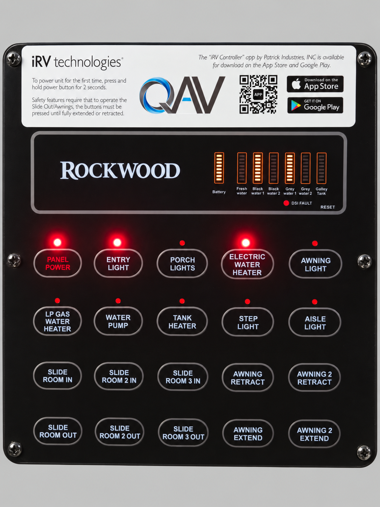

# Panel identification and compatibility

## TP33 panel reference

The reference image was edited with AI to remove reflections and surrounding details. Embedded metadata was stripped. It is for recognizing the face/layout, not for reading precise LED levels, reproducing a QR code or establishing compatibility by appearance. Hardware labels and logos remain associated with their respective companies.

This layout has Panel Power; Entry, Porch, Awning, Step and Aisle lights; electric/LP water heater controls; water pump; tank heater; three slide rooms; two awnings; and battery/tank indicators. A label near the top advertises the original iRV Controller app.

## Android requirements

The APK requires Android 12/API 31 or later and Bluetooth Low Energy. Phone age alone is not the criterion: an older phone updated to a qualifying Android version may meet those requirements. No native CPU-specific libraries are packaged. Firmware, radio behavior and controller mappings can still differ between devices.

This Android APK does not run on iOS. The availability of the original iOS app is outside the scope of this project.

## Controller requirements

The implementation uses the service/characteristics, packet format, state bitfield and command mapping documented in DEVELOPER-GUIDE.md. A TP33 broadcast name, familiar faceplate or matching UUID does not by itself establish that each command controls the intended output. Other panel variants may need different mappings or protocol handling.

The app does not measure slide/awning positions, endpoints or travel percentages. Tank readings reproduce the panel's sensor reports. Battery bars are relative panel levels, not a calibrated charge percentage. Bluetooth acknowledgements do not independently measure mechanical motion or stopping.

## Additional panel variants

To propose another controller variant, open a project issue with its model, a permitted and sanitized reference photo, relevant protocol details and the changes needed for integration. Do not include VINs, serial numbers, personal Bluetooth addresses or unredacted exports. Additional reference images and variant-specific integration notes can be added to this guide as the project grows.

Project issues: https://github.com/Psolve0/tp33-irv-controller/issues
